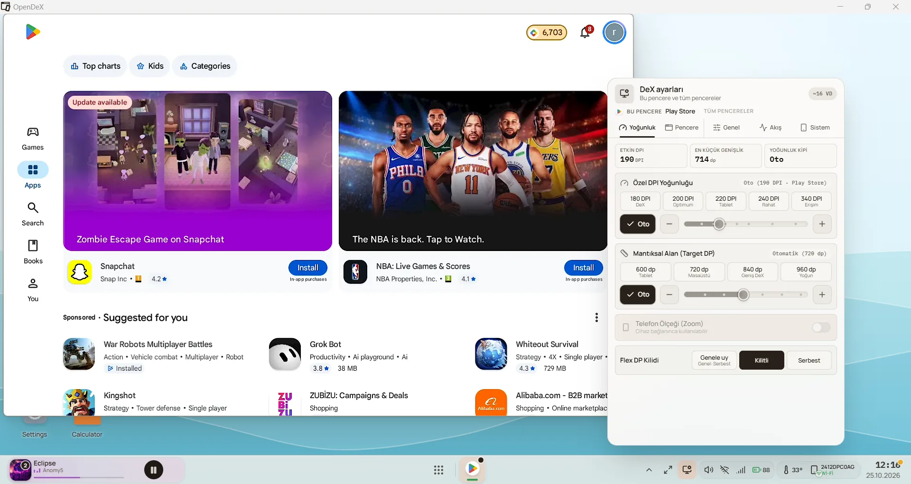
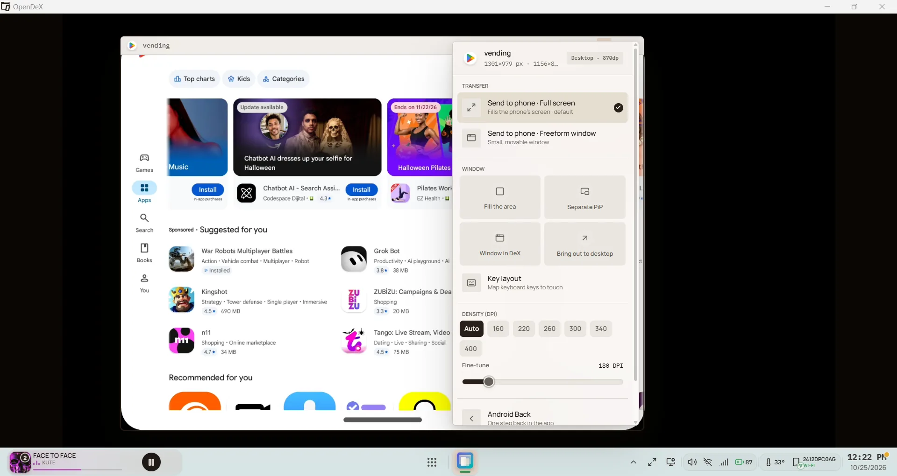
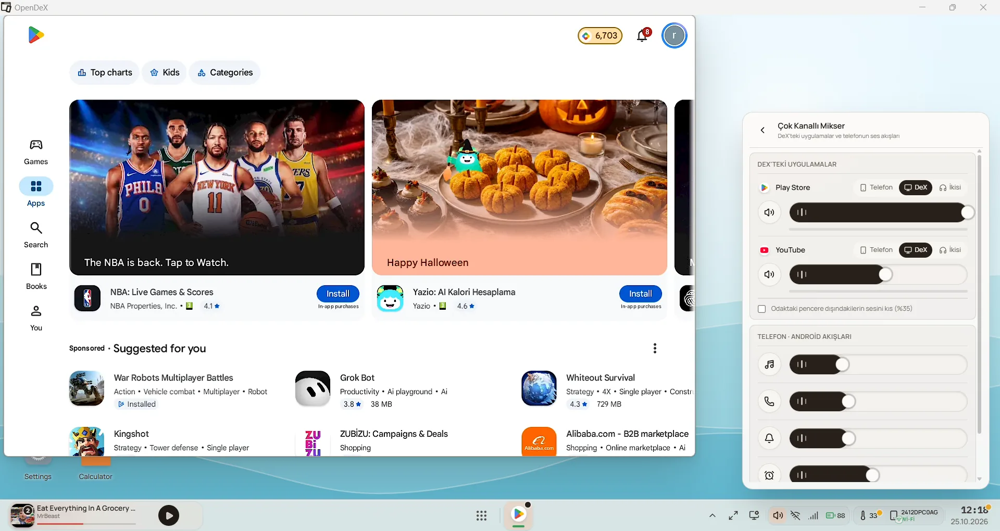
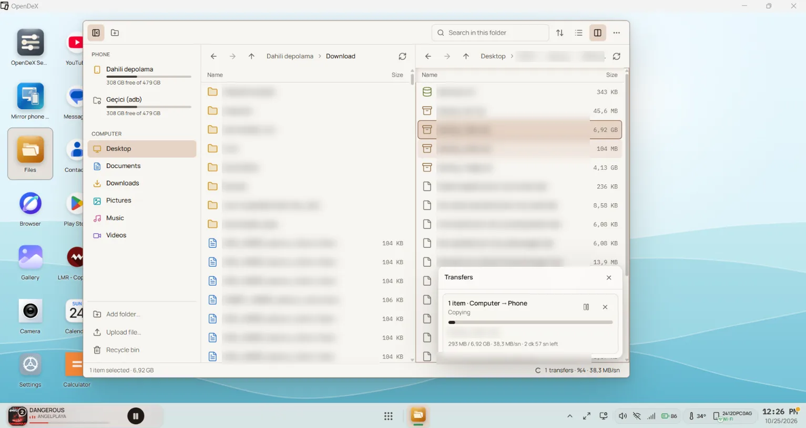
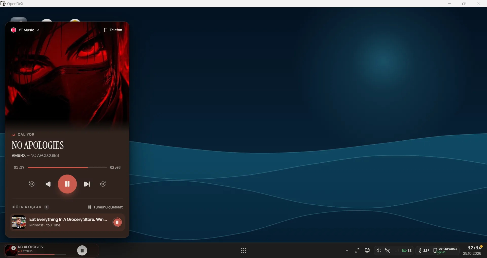
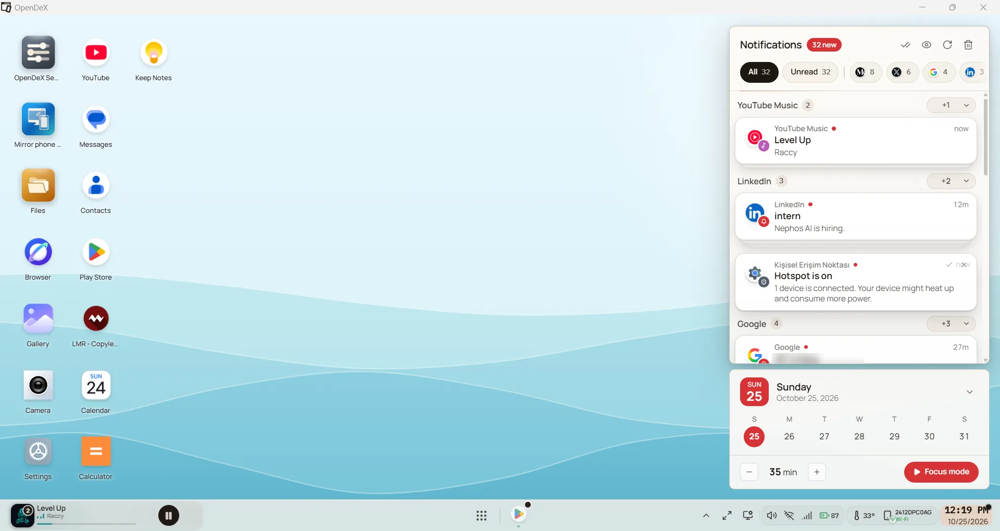
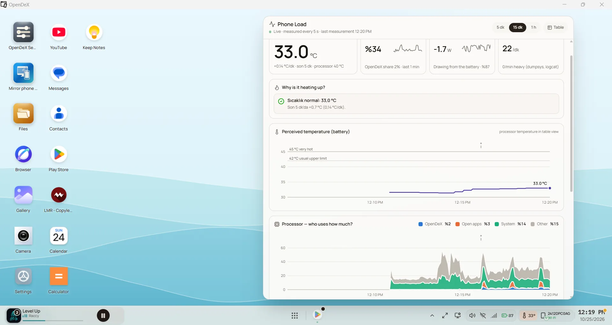
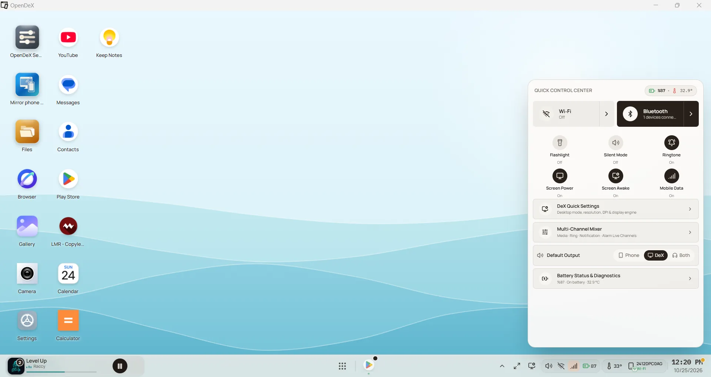
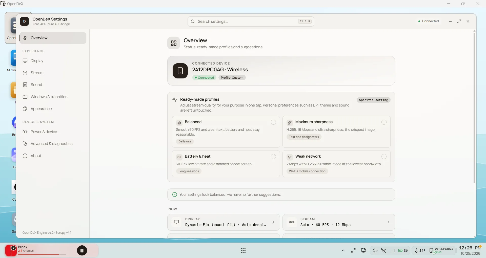

# OpenDeX

**Your Android phone as a multi-window desktop on Windows.**
Every app in its own resizable window — with its own sound, a taskbar, a file manager and your notifications.

[Download](#download) · [Install](docs/INSTALL.md) · [Documentation](docs/README.md) · [Türkçe](README.tr.md)

## Hand an app over, take it back

<!-- TODO: add docs/images/live/handoff.gif (6-10 s: app in a PC window -> "Send to phone" -> phone screen -> back), then uncomment:

-->

Screen mirroring shows the phone's *one* screen in *one* window. OpenDeX gives **each app its own virtual display** and its own window, so apps run side by side — and one click
hands a running app to the phone's screen and back. Nothing is installed on the phone and no root is needed; OpenDeX drives it over `adb`, building on [scrcpy](https://github.com/Genymobile/scrcpy).

## What you get

<table>
<tr>
<td width="50%"> <b>One hub per window.</b> Send it to the phone, snap, picture-in-picture, key layout, density.</td>
<td width="50%"> <b>Sound per app.</b> Send each app to the phone, the PC or both, kept in step. <a href="docs/AUDIO.md">How</a></td>
</tr>
<tr>
<td> <b>Files.</b> Phone and PC side by side, resumable transfers, previews.</td>
<td> <b>Media Center.</b> Control whatever plays on the phone, pause all streams at once.</td>
</tr>
<tr>
<td> <b>Notifications.</b> Grouped by app; open or reply from the desktop.</td>
<td> <b>Phone Load.</b> CPU, temperature and what OpenDeX asks of the phone, in plain words.</td>
</tr>
<tr>
<td> <b>Quick controls.</b> Wi-Fi, Bluetooth, torch, volumes, default sound output.</td>
<td> <b>Settings.</b> Ready-made profiles for quality, battery or a weak network.</td>
</tr>
</table>

## Download

**Windows (x64)** — from the [`download/`](download/) folder or the [Releases page](https://github.com/Lordof21/OpenDex/releases) (checksums in `SHA256SUMS.txt`):

* `OpenDeX_0.1.0_x64_tr-TR.msi` — installer
* `OpenDeX_0.1.0_windows-x64_portable.zip` — unzip and run `opendex.exe`

The builds are **unsigned**, so SmartScreen may warn (*More info → Run anyway*).

## Get started

1. Install Android **platform-tools** (`adb`) and turn on **USB debugging** on the phone.
2. Install OpenDeX, plug the phone in, accept the prompt.
3. Open OpenDeX and pick an app. No cable? The pairing dialog does QR / code pairing over Wi-Fi.

Details and per-Android-version notes: **[docs/INSTALL.md](docs/INSTALL.md)**. From source: **[docs/DEVELOPMENT.md](docs/DEVELOPMENT.md)**.

> **Pre-1.0.** Verified on one phone (Xiaomi POCO X7 Pro, Android 16) — [what is verified](docs/DEVICE_COMPATIBILITY.md). The interface speaks **20 languages** (machine-translated, not yet reviewed by native speakers — [translating](docs/TRANSLATING.md)); code, API and docs are English.

## More

[Troubleshooting](docs/TROUBLESHOOTING.md) · [FAQ](docs/FAQ.md) · [Architecture](docs/ARCHITECTURE.md) · [API](docs/API.md) · [Security model](docs/SECURITY_MODEL.md) · [Roadmap](docs/ROADMAP.md) · [Changelog](CHANGELOG.md) · [Contributing](CONTRIBUTING.md)

Local only: no accounts, no cloud, no telemetry. The backend is a local HTTP/WebSocket API — the UI is one client of it ([API](docs/API.md)).

[GPL-3.0-or-later](LICENSE). Builds on [scrcpy](https://github.com/Genymobile/scrcpy) (Apache-2.0) and other open-source components — [THIRD_PARTY_NOTICES.md](THIRD_PARTY_NOTICES.md).
"Android" is a trademark of Google LLC; OpenDeX is not affiliated with or endorsed by Google, Samsung or Genymobile.
