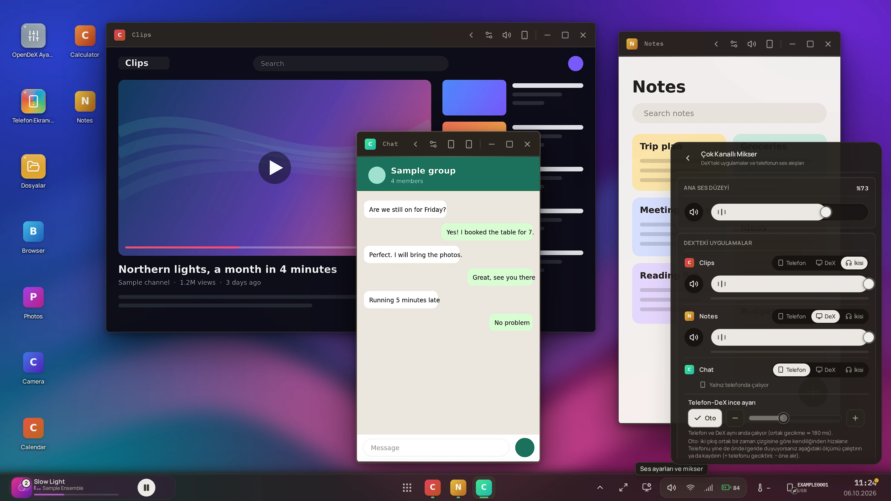

# Audio

OpenDeX can play an app's sound **on the phone, on the computer (DeX), or on both** — chosen per app, changed live — and keeps the
two copies in step when you pick *both*.

## The three routes

| Route | UI label | The app's sound plays… |
|---|---|---|
| `phone` | **Telefon** | on the phone only (the app's window is just a picture) |
| `pc` | **DeX** | on the computer only; the phone is silenced for that app |
| `both` | **İkisi** | on both, at the same instant |

The route is a **saved preference per app** (`PUT /audio/apps/{package}`), applied to the app's open windows, with a default from the
*Output* setting (`audio_output_mode`, which starts as **DeX**) for apps you have not set. Sound that belongs to no window — notifications, calls, an app you
have not opened in OpenDeX — keeps playing on the phone.

The mixer lives in **Quick settings → Çok Kanallı Mikser** (taskbar → the speaker icon); the route chip also appears on the Media
Center's session rows (**long-press** it for the three choices). The Media Center can additionally *transfer* an app that has no
window to the computer, and send it back.

## Two ways of capturing — chosen by Android version

| Mode | Android | How |
|---|---|---|
| **`per_app`** | 13+ (API 33) | The phone helper creates an `AudioPolicy` that captures **one app's playback** (matched by the app's UID) and mutes it on the phone when the route says so. Each window gets its **own PCM channel**: `/ws/audio/{window_id}`. |
| **`legacy`** | 11–12, or an old helper | scrcpy's session audio: **one stream for the whole phone** (`/ws/audio`). There is no per-app choice; the *Output* setting decides whether it plays on the computer. |
| `pending` | 13+, while connecting | Waiting for the helper's greeting. The legacy stream is *suppressed* meanwhile (so nothing plays twice), and a 10-second timer falls back to `legacy`. |
| `off` | — | No phone. |

`GET /audio/apps` reports `mode`, every app's state (`route`, `live_route` — what the phone is *actually* doing, `volume`, `muted`,
`error`, …) and the sync block; the `app_audio_mode` and `app_audio_state` events keep the UI current ([API.md](API.md#event-types)).
If the phone cannot do what was asked, the app's `error` says why and it keeps playing on the phone.

Format on every channel: **signed 16-bit little-endian PCM, stereo, 48 kHz**, in 12-byte-header frames
([API.md → audio](API.md#wsaudio-and-wsaudiowindow_id--pcm)). PCM is used because it needs no decoder and adds no latency; the price is
bandwidth (≈ 1.5 Mbit/s per app), which is nothing for USB and acceptable for Wi-Fi.

One consumer per channel: opening a second tab or hot-reloading the page *replaces* the first listener, so a sound never plays twice.

### The reconcile loop

One loop owns the phone side. The desired state is **derived**, never tracked incrementally: which windows exist, whether each app is on
the phone right now (hand-off), the saved route per package, the standalone transfers. Every trigger — a window opening or closing, a
hand-off, a changed preference, a helper reconnect, a capture that died — only calls `request_sync()`. Missing a trigger therefore costs
latency, never correctness. (`backend/app/streams/app_audio.py`.)

## How the routes stay in sync

*(This is the anchor the API page links to.)* Picking **both** is harder than it sounds: the phone plays the app immediately, while the
computer's copy arrives after capture buffering, the adb link, the backend relay and the page's own audio buffers — 100–300 ms, and not
constant. Left alone, you hear an echo. OpenDeX puts both outputs on **one timeline**:

1. Every captured chunk carries the phone clock's time of its first frame (**PTS**).
2. Each output presents it at **`PTS + target`**:
   * the **phone**: the helper silences the app and plays the capture itself through an `AudioTrack`, placed by the track's own timestamps
     (`audio_route <package> both <phone_target_ms>`);
   * the **computer**: the page converts the PTS to its own clock using the **device-clock offset** it measures (`POST /audio/clock`, a
     few round trips, the quickest wins) and schedules each chunk with Web Audio at `PTS + target`.
3. The **target** is the least latency that every chunk can meet: the page's output-device latency + one chunk + the link + the relay +
   a jitter margin (60 ms to start with). When the page reports chunks that arrived too late (`PUT /audio/sync`) the margin grows quickly (30 ms per report with two or more late chunks, up to 300 ms) and relaxes slowly (10 ms after three calm minutes), because a late chunk is an audible gap.
4. A helper without the `audio_playout` capability, or a phone that cannot build the playback track, falls back to *native* phone playback
   (the state says `synced: false`, and the UI says so).

### Fine tune and automatic calibration

Both sides only know what their own platform reports: the phone's `AudioTrack` timestamp stops at the audio HAL, the page's `AudioContext` at
the OS audio engine. A speaker's DSP, a driver's effects and the clock-offset error are in neither. That residual is **constant for a given
phone + computer + link** — and no software number can tell it; an ear or a microphone can. So the setting **`audio_sync_offset_ms`** moves the
*phone's* copy, and the *Telefon–DeX ince ayarı* control offers two ways to set it:

* by ear: the −/+ buttons;
* **Oto**: the computer's **microphone** records while the phone plays a rising chirp and the page plays a falling chirp, a known interval
  apart, for several pairs. A matched filter finds each chirp to a fraction of a millisecond; the median difference, minus the planned gap, is the
  unmodelled error — and since both chirps are in the *same* recording, the microphone's own latency cancels out. The two sides sweep **disjoint
  bands** (phone 1.5 → 3.1 kHz, page 5.1 → 3.5 kHz) so a loud copy never masquerades as the quiet one. Nothing is guessed: a pair that cannot
  be found, or pairs that disagree by more than 3 ms, fail the whole run **without touching the setting**.
  (`frontend/src/media/syncCalibration.js`, `backend/java/src/com/opendex/tools/ProbeTone.java`, `AudioProbe.java`; endpoint `POST /audio/probe`.)

Calibration needs microphone permission for the page. It is the only place OpenDeX uses the microphone, only while you press *Oto*, and the
recording never leaves the page.

## Weak or unstable links

The phone's sound reaches the computer over adb, usually Wi-Fi, which stalls, drops and comes back. The aim is to lose a little sound,
never to stay silent afterwards:

* **Phone → PC.** The end of a stream is never lost (the phone holds it for the next connection), an idle channel sends a keepalive
  every second, and the backend reconnects after 4 s of silence (a half-open socket) and 0.25–2 s after a drop.
* **Android ≤ 12** (one stream for the whole phone, `/ws/audio`): when its adb socket ends unasked it is reopened by itself (0.5 s,
  doubling to 8 s while it keeps failing).
* **Browser.** The cushion in front of playback adapts (`media/jitterBuffer.js`): 50 ms on a clean link, up to 400 ms after the link
  has run the queue dry mid-stream, given back slowly. A pause of the app is not mistaken for a bad link.

A stall longer than the cushion is still one gap — a buffer cannot play sound that has not arrived — but the cushion is larger afterwards.

## Several apps playing at once (multi-app sound)

Android normally lets one app hold the audio focus: when a second app starts, the first is paused (or its focus request is refused). That
defeats "this app on the PC, that one on the phone". The phone's **multi audio focus** flag lets both play. OpenDeX shows it, checks it and
(with your consent) sets it — **Settings › Sound › Multi-app sound**:

* **Status** (*On / Off / Not supported / Not applied*) with the time of the last reading and a **Check again** button. Nothing polls the
  phone: it is read when the card opens, on that button, after a change, and when a phone is bound.
* **Turn on** sets the flag through the audio service and then **reads it back** — a call that returns quietly but changes nothing is shown
  as *Not applied*, not as a success. (Measured on HyperOS 3.0 / Android 16: the Settings key `multi_audio_focus_enabled` can read `1`
  while the service says `Multi Audio Focus enabled :false`, and flipping that key does nothing.)
* **When to apply**: *Ask* (default — only when you agree, for that session), *Always* (automatically while OpenDeX windows are open),
  *Never*. Whatever you choose, the phone goes back to its previous value when the last window closes, the phone is unplugged or OpenDeX
  exits; a flag that was **already on** is never touched.
* The first time an app is paused because another one started, OpenDeX asks **once per run** whether to turn it on (a small card that never
  takes the keyboard focus). *Don't ask again* sets the policy to *Never*.
* The mixer shows a small "Multi-app sound is off" pill while the flag is off; the DeX panel › System tab has a shortcut to the same card.

It changes the behaviour of **all** media apps on the phone while it is on — also when you use the phone directly.

**It is not a guarantee.** The flag is Android's; a phone maker can add its own focus handling on top. Measured on a POCO X7 Pro (HyperOS 3.0,
Android 16): with the flag on, two apps *did* play together, but starting a second app could still pause the first — the system log shows Xiaomi's
own focus notifier (`FocusRequesterStubImpl`) telling the first app a few milliseconds before it pauses itself, and Android 16's *audio
hardening* refusing some apps' focus requests (`AudioFocus DENIED` in their logs). We found no switch for either. What the user reported
working there: **closing the background apps on the phone to free its memory (RAM)** — the card and the DeX panel say so as a hint ("may fix it");
the cause is not explained.

## Settings and API at a glance

| | |
|---|---|
| Settings (`PUT /settings`) | `enable_audio` (default on), `audio_output_mode` (`pc` — the default — / `phone` / `both`), `audio_sync_offset_ms` (−300…+500 ms, default 0), `audio_codec` (`raw` PCM is the default; `opus` is reserved) — [CONFIGURATION.md](CONFIGURATION.md) lists the backend-side `OPENDEX_*` variables |
| REST | `GET /audio/apps`, `PUT /audio/apps/{package}`, `PUT /audio/sync`, `POST /audio/clock`, `POST /audio/probe`, `GET /audio/multi-focus`, `POST /audio/multi-focus/recheck`, `PUT /audio/multi-focus` — [REFERENCE](api/REFERENCE.md#audio) |
| WebSocket | `/ws/audio`, `/ws/audio/{window_id}` |
| Events | `app_audio_mode`, `app_audio_state`, `multi_audio_focus_update` |
| Phone helper | `audio_route`, `audio_target`, `audio_probe`, `audio_stop`, `audio_list`, `audio_multi_focus` + the `opendex_audio` socket — [DAEMON_PROTOCOL.md](DAEMON_PROTOCOL.md#per-app-audio) |

## Known limits

* Per-app capture needs **Android 13+**. Below it there is a single session stream.
* Everything about *both* is verified by tests of the arithmetic and the protocol; how good it **sounds** depends on the phone, the PC's audio driver
  and the link, which is why the calibration exists. The audio checks that need ears are in [DEVICE_CHECKLIST.md](DEVICE_CHECKLIST.md) (§9).
* PCM over Wi-Fi is bandwidth-hungry and sensitive to a weak link; a stalled consumer loses the *oldest* audio (freshness over completeness).
